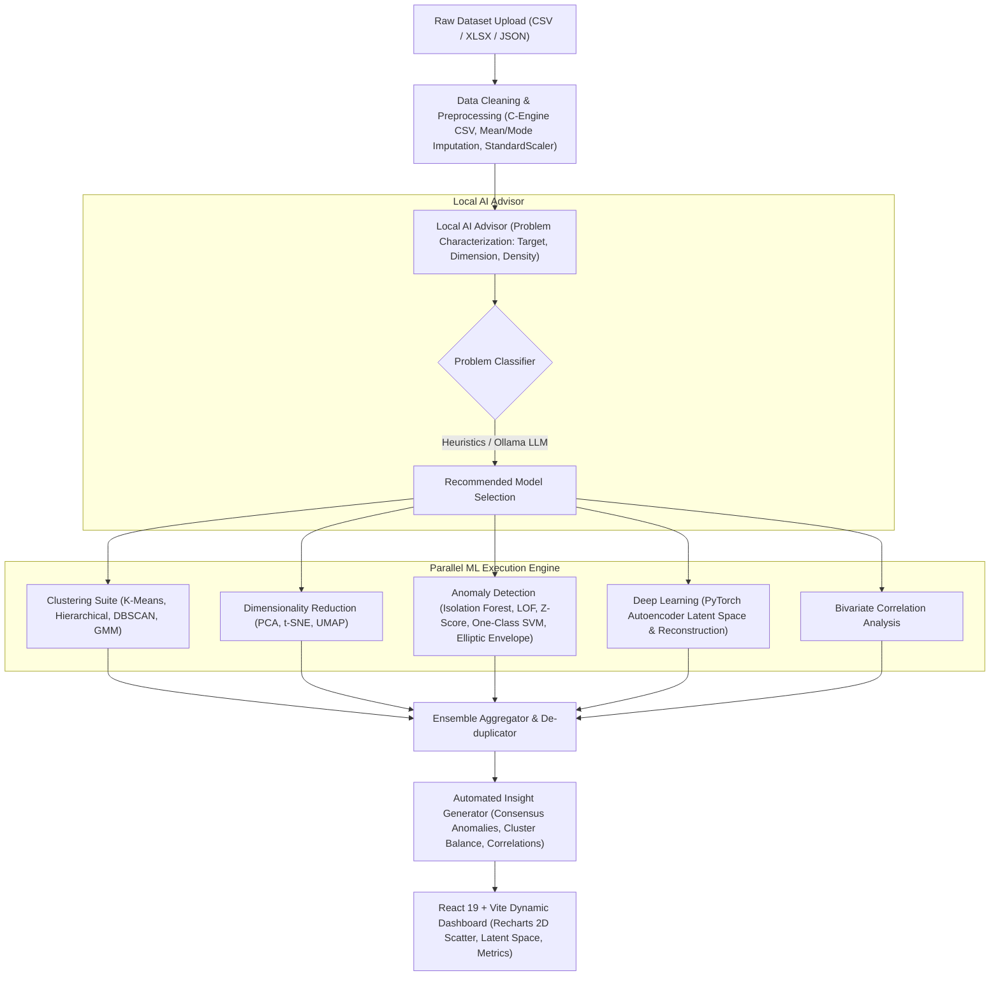

# AutoPattern 🧠🔍

[](https://fastapi.tiangolo.com)
[](https://react.dev)
[](https://vitejs.dev)
[](https://pytorch.org)
[](https://scikit-learn.org)
[](https://python.org)

**AutoPattern** is an end-to-end automated exploratory data analysis (EDA), unsupervised pattern discovery, and anomaly detection platform. It ingests arbitrary structured tabular datasets (CSV, Excel, JSON), applies an intelligent **Local AI Advisor** to profile dataset topology, executes an ensemble of **14 machine learning and statistical models** in parallel, and delivers de-duplicated, actionable natural language insights.

---

## 🏛️ System Architecture



---

## 🚀 Key Features

* **Zero-Configuration Local AI Advisor**: Profiles row count, column cardinality, categorical-to-numeric ratio, and dimensional sparsity in $\sim 100\text{ms}$. Automatically selects optimal models with fallback support for local LLMs (Ollama with `llama3` or `mistral`).
* **Complete 14-Model Machine Learning Suite**: Spans centroid clustering, density-based clustering, spectral hierarchies, Gaussian mixtures, linear/non-linear manifold reductions, kernel methods, robust covariance estimators, and deep neural networks.
* **Ensemble De-duplicated Anomaly Detection**: Solves the common multi-detector double-counting problem by performing row-wise mask union across all 6 anomaly models to report true unique outliers and multi-model consensus.
* **High-Performance Asynchronous Backend**: Built on FastAPI and `asyncio.to_thread` for non-blocking multi-core parallel model execution with in-memory caching.
* **Modern Reactive UI**: React 19 single-page dashboard built with Vite, Zustand, and Recharts, featuring synchronized PCA scatter plots, interactive latent space visualizations, and metric comparison cards.

---

## 🔬 Suite of 14 Machine Learning Models

### 1. Pattern Discovery & Clustering
| # | Model | Library / Class | Optimization / Objective | Use Case & Strengths |
|---|---|---|---|---|
| 1 | **K-Means Clustering** | `sklearn.cluster.KMeans` | Minimizes inertia / Within-Cluster Sum of Squares (WCSS) via `k-means++` | Rapid partition of isotropic, globular clusters |
| 2 | **Hierarchical Clustering** | `sklearn.cluster.AgglomerativeClustering` | Ward linkage bottom-up variance minimization | Discovers nested cluster tree hierarchies ($N < 2,000$) |
| 3 | **DBSCAN** | `sklearn.cluster.DBSCAN` | Density reachability with $\varepsilon$-neighborhood and `min_samples` | Finds arbitrary non-convex shapes; isolates noise points |
| 4 | **Gaussian Mixture Model (GMM)** | `sklearn.mixture.GaussianMixture` | Expectation-Maximization (EM) fitting Gaussian covariance matrices | Soft probabilistic clustering with uncertainty scores |

### 2. Dimensionality Reduction & Manifold Learning
| # | Model | Library / Class | Mathematical Foundation | Use Case & Strengths |
|---|---|---|---|---|
| 5 | **PCA** | `sklearn.decomposition.PCA` | Orthogonal eigen-decomposition maximizing variance | Global linear projection and baseline 2D/3D axes |
| 6 | **t-SNE** | `sklearn.manifold.TSNE` | Minimizes KL divergence over Student-$t$ distribution | Preserves non-linear local neighborhood topology |
| 7 | **UMAP** | `umap.UMAP` | Fuzzy simplicial set topology and cross-entropy optimization | Scalable non-linear reduction preserving both local and global structure |
| 8 | **Correlation Matrix** | `pandas.DataFrame.corr` | Pairwise Pearson bivariate coefficient ($r \in [-1, 1]$) | Identifies multicollinearity and strong feature linkages ($|r| > 0.7$) |

### 3. Anomaly & Outlier Detection
| # | Model | Library / Class | Algorithmic Mechanism | Detection Target |
|---|---|---|---|---|
| 9 | **Isolation Forest** | `sklearn.ensemble.IsolationForest` | Random binary tree partitions; anomalies isolate with shorter path length | Global multi-dimensional outliers |
| 10 | **Local Outlier Factor (LOF)** | `sklearn.neighbors.LocalOutlierFactor` | $k$-NN ratio of local reachability density against neighbors | Local density deviations in variable-density data |
| 11 | **Z-Score Detection** | `numpy` / `scipy` | Univariate thresholding ($|Z| = \left\|\frac{x - \mu}{\sigma}\right\| > 3.0$) | Extreme Gaussian statistical extremes ($\pm 3\sigma$) |
| 12 | **One-Class SVM** | `sklearn.svm.OneClassSVM` | Maximum-margin hyperplane wrapping normal data with RBF kernel | Non-linear geometric boundary outliers |
| 13 | **Elliptic Envelope** | `sklearn.covariance.EllipticEnvelope` | FastMCD robust Mahalanobis covariance estimation | Covariance-distorted outliers in Gaussian data |
| 14 | **Deep Autoencoder** | `torch.nn` (PyTorch) | Multi-layer bottleneck compression with Mean Squared Reconstruction Error | Complex, non-linear structural anomalies |

---

## 🛠️ Getting Started

### Prerequisites
* **Python**: 3.10+ (tested on Python 3.13)
* **Node.js**: v18+ with `npm`

---

### Step 1: Backend Setup (FastAPI)

From the project root:

```powershell
# 1. Activate the virtual environment
.\venv\Scripts\activate

# 2. Install dependencies (if setting up fresh)
pip install -r requirements.txt

# 3. Start the FastAPI ASGI server
python -m uvicorn backend.main:app --reload --port 8000
```

* **Interactive API Documentation (Swagger)**: `http://127.0.0.1:8000/docs`
* **Alternative ReDoc**: `http://127.0.0.1:8000/redoc`

---

### Step 2: Frontend Setup (Vite + React)

In a separate terminal window:

```powershell
# 1. Navigate to the frontend directory
cd frontend

# 2. Install dependencies
npm install

# 3. Start the Vite development server
npm run dev
```

* **Web Application UI**: `http://localhost:5173`

---

## 🔌 API Reference

| Method | Endpoint | Description |
|---|---|---|
| `POST` | `/upload_dataset` | Ingests CSV/XLSX/JSON, performs validation, caches to disk, and returns unique file hash path. |
| `GET` | `/recommend` | Runs the Local AI Advisor to profile metadata and return recommended models with reasoning. |
| `GET` | `/analyze` | **Unified Pipeline**: Concurrently runs summary stats, selected pattern models, anomaly models, PyTorch autoencoder, and generates de-duplicated insights. |
| `GET` | `/dataset_summary` | Returns column statistics, missing value profiles, and distribution metrics. |
| `GET` | `/pattern_analysis` | Executes and returns clustering labels, PCA projections, and correlation matrix. |
| `GET` | `/anomaly_detection` | Runs the 5 statistical and classical ML anomaly detectors. |
| `GET` | `/dl_anomaly_detection` | Trains the PyTorch neural autoencoder and returns latent vectors and reconstruction errors. |
| `GET` | `/insights` | Returns rule-based and LLM-synthesized natural language analytical conclusions. |

---

## 📁 Project Structure

```
AutoPattern/
├── backend/
│   ├── main.py                  # FastAPI application & consolidated endpoints
│   ├── models.py                # Pydantic response schemas
│   ├── requirements.txt         # Backend dependency pin
│   └── utils.py                 # Multi-format dataset loader (CSV, Excel, JSON)
├── execution/
│   ├── anomaly_detection.py     # Isolation Forest, LOF, Z-Score, One-Class SVM, Elliptic Envelope
│   ├── autoencoder_model.py     # PyTorch Deep Learning Autoencoder neural net
│   ├── insight_generator.py     # Rule heuristics & LLM insight engine
│   ├── local_llm.py             # Ollama integration with graceful offline fallback
│   ├── model_selector.py        # Rule-based & LLM advisor model filtering
│   ├── pattern_detection.py     # K-Means, Hierarchical, DBSCAN, GMM, PCA, t-SNE, UMAP
│   ├── preprocessing.py         # Missing-value imputation, label encoding, StandardScaler
│   └── problem_detector.py      # Automated dataset characterization (Task, Dimensionality)
├── frontend/
│   ├── src/
│   │   ├── components/          # Reusable UI widgets (AIAdvisorCard, Charts)
│   │   ├── panels/              # AnomaliesPanel, PatternsPanel, InsightsPanel
│   │   ├── services/            # Axios API client
│   │   └── store/               # Zustand global state management
│   ├── package.json             # React 19, Vite, Recharts, Lucide dependencies
│   └── vite.config.js           # Vite bundle configuration
├── test_dataset.csv             # Benchmark sample dataset
├── requirements.txt             # Primary Python virtual environment requirements
└── README.md                    # Platform documentation
```

---

## 🧪 Testing

Run smoke tests and advisor selectivity verification from the root directory:

```powershell
# Test end-to-end advisor, preprocessing, model execution, and insights
.\venv\Scripts\python test_local_advisor.py

# Test advisor selectivity across different dataset topologies
.\venv\Scripts\python test_selectivity.py
```

---

## 📜 License

Distributed under the MIT License. Developed for automated machine learning analytics and pattern discovery.
